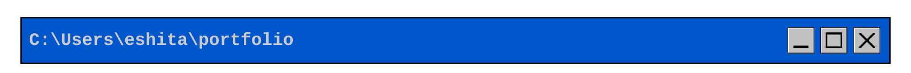
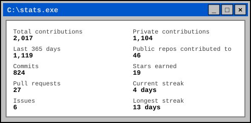
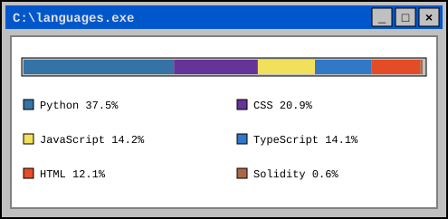

<div align="center">



<br/>

# Eshita Kundu

Agentic AI engineer: LLM agents, MCP servers, and the guardrails and evals around them.

</div>

---

## `~/now`

```text
building        LLM agents, MCP servers, tool-use guardrails
contributing    amd/gaia (MCP and agent runtime)
working with    python, fastapi, postgres, docker
environment     windows + wsl
```

---

## `~/github`

<table>
<tr>
<td width="50%" valign="top">

### shipped

- [TraceIntel](https://traceintel.eshita.dev): audits old token approvals against live chain state
- [ARIS](https://aris.eshita.dev/): evidence-backed verdicts on developer tools
- [DevPulse](https://devpulse.eshita.dev): Hacker News pros and cons, every point quoted
- [Jev Flow](https://jevflow.eshita.dev): LLM triage with human review below a threshold
- [MoodIfy](https://moodify.eshita.dev): songs matched to how you feel
- [study-buddy](https://github.com/eshitakundu/study-buddy): MCP server for notes and past papers

</td>
<td width="50%" valign="top">

### open source

- [amd/gaia](https://github.com/amd/gaia/pulls?q=is%3Apr+author%3Aeshitakundu): MCP fixes in AMD's agent framework: an HTTP transport that follows the spec, connectors that pick up catalog updates, and bridge calls that stop when the client hangs up
- [CrossGL/crosstl](https://github.com/CrossGL/crosstl/pulls?q=is%3Apr+author%3Aeshitakundu): WGSL codegen for struct, vector and matrix initializers
- [ai-engineering-from-scratch](https://github.com/rohitg00/ai-engineering-from-scratch/pulls?q=is%3Apr+author%3Aeshitakundu): tutor-skill lesson counts and fairer quiz answers for the LLM lessons
- [heymrun/heym](https://github.com/heymrun/heym/issues/135): proposed the Python Exec node

</td>
</tr>
</table>

---

## `~/activity`

<div align="center">




</div>

---

## `~/toolbox`

<div align="center">

[](https://skillicons.dev)

`Pydantic` · `MCP` · `LangGraph` · `NOOA` · `OpenRouter` · `pgvector` · `uv` · `GitHub Actions` · `EVM`

<br/>


</div>
