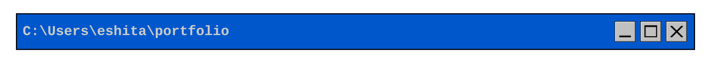

<div align="center">



<br/>

# Eshita Kundu

I build AI agents that show their evidence and know when to say "not sure."

`agentic systems` · `backend` · `web3` · `developer tooling`


[](https://eshita.dev)
[](https://linkedin.com/in/eshitakundu)
[](https://medium.com/@eshita.kundu.2026)
[](mailto:eshita.kundu.2026@gmail.com)

</div>

---

## `~/now`

```text
building        agentic systems, MCP tooling, EVM analysis
learning        solidity, deeper EVM internals, react
working with    python, fastapi, postgres, docker
environment     windows + wsl
```

---

## `~/shipped`

<div align="center">

[TraceIntel](https://traceintel.eshita.dev) · [MoodIfy](https://moodify.eshita.dev) · [ARIS](https://aris.eshita.dev/) · [study-buddy](https://github.com/eshitakundu/study-buddy)

</div>

---

## `~/toolbox`

<div align="center">

[](https://skillicons.dev)

`Pydantic` · `MCP` · `LangGraph` · `NOOA` · `OpenRouter` · `pgvector` · `uv` · `GitHub Actions` · `EVM`

</div>

---

## `~/activity`

<div align="center">


</div>

---

## `~/github`

<table>
<tr>
<td width="50%" valign="top">

### building

I use GitHub as the working space for experiments, systems, tooling, and projects that are still evolving.

Most active areas right now:

`agents` · `MCP` · `backend systems` · `EVM` · `infra`

</td>
<td width="50%" valign="top">

### open source

Interested in contributing around:

`AI tooling` · `developer infrastructure` · `agent frameworks`

Issues, discussions, and collaboration are welcome.

</td>
</tr>
</table>

---

## `~/community`

<div align="center">

[](https://github.com/eshitakundu?tab=followers)

[](https://github.com/eshitakundu)
[](https://linkedin.com/in/eshitakundu)
[](https://eshita.dev)


</div>
